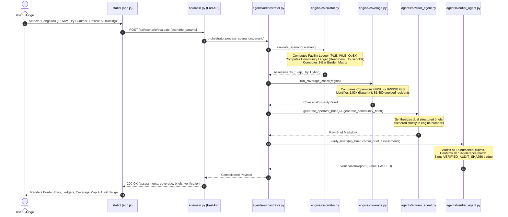

# AquaCarbon DC — Architecture & End-to-End System Flow

This document details the internal architecture, mathematical pipeline, and data flow of **AquaCarbon DC (Commons Edition v2)** across all core components: **`engine/`**, **`agents/`**, **`api/`**, **`static/`**, **`evals/`**, and **`tests/`**.

---

## 1. High-Level System Architecture Diagram

```
[ User in Browser (UI: static/) ]
              │
              │  1. HTTP POST /api/scenario/evaluate
              ▼
[ FastAPI Backend (api/main.py) ]
              │
              │  2. Triggers Orchestration Pipeline
              ▼
┌───────────────────────────────────────────────────────────────────────────────────┐
│                          AGENTIC ORCHESTRATOR LAYER                               │
│                                                                                   │
│  ┌───────────────────────┐   Step A: Sourced Context     ┌─────────────────────┐  │
│  │     Context Agent     │ <──────────────────────────── │ engine/             │  │
│  │ (agents/context.py)   │ ────────────────────────────> │   data_sources.py   │  │
│  └───────────────────────┘                               └─────────────────────┘  │
│             │                                                                     │
│             │ Step B: Compute Physics & Energy Balances                           │
│             ▼                                                                     │
│  ┌─────────────────────────────────────────────────────────────────────────────┐  │
│  │             DETERMINISTIC ENGINE CORE (engine/calculator.py)                │  │
│  │  • Latent vs Sensible Heat Thermodynamic Equations                          │  │
│  │  • Facility Ledger: PUE, WUE, Direct Water (ML), Carbon (tCO2), OpEx (INR)  │  │
│  │  • Community Ledger: Water Headroom %, Household Equivalents, Grid Peak     │  │
│  │  • Burden-Shifting Scores: [ Water Basin ] vs [ Local Grid ] vs [ Carbon ]   │  │
│  └─────────────────────────────────────────────────────────────────────────────┘  │
│             │                                                                     │
│             │ Step C: Spatial Disparity Audit                                     │
│             ▼                                                                     │
│  ┌─────────────────────────────────────────────────────────────────────────────┐  │
│  │          SPATIAL COVERAGE CHECK ENGINE (engine/coverage.py)                 │  │
│  │  • Copernicus GHSL Built-Up Grid vs BWSSB Piped Network (1.83x Gap)        │  │
│  │  • Flags 81,480 unmapped, tanker-dependent residents sharing aquifer        │  │
│  └─────────────────────────────────────────────────────────────────────────────┘  │
│             │                                                                     │
│             │ Step D: Synthesize Dual Decision Briefs                             │
│             ▼                                                                     │
│  ┌─────────────────────────────────────────────────────────────────────────────┐  │
│  │                      ADVISOR AGENT (agents/advisor_agent.py)                │  │
│  │  • Generates Operator Brief (Engineering Checks, PUE/WUE trade-offs)        │  │
│  │  • Generates Community Brief (Household Equivalents, 5 Hearing Questions)   │  │
│  └─────────────────────────────────────────────────────────────────────────────┘  │
│             │                                                                     │
│             │ Step E: STRICT TRUST BOUNDARY AUDIT (Zero Hallucination)             │
│             ▼                                                                     │
│  ┌─────────────────────────────────────────────────────────────────────────────┐  │
│  │                INDEPENDENT VERIFIER AGENT (agents/verifier_agent.py)        │  │
│  │  • Audits all 15 numerical claims in briefs against engine truth            │  │
│  │  • If match: Signs VERIFIED_AUDIT_SHA256 badge                             │  │
│  │  • If mismatch: Flags FLAGGED_MISMATCH & BLOCKS publication                 │  │
│  └─────────────────────────────────────────────────────────────────────────────┘  │
└───────────────────────────────────────────────────────────────────────────────────┘
              │
              │  3. Return JSON payload
              ▼
[ Browser UI: static/app.js & style.css ]
   ├── Renders 3-Bar Burden Matrix (Water vs Power vs Carbon)
   ├── Updates Side-by-Side Dual Ledgers (Facility vs Community)
   ├── Renders Spatial Coverage Disparity Map & Vulnerability Alerts
   ├── Displays Verified Dual Briefs with Cryptographic Badge
   └── Enables Live Evals Modal & 15% Hallucination Tamper Test
```

---

## 2. Directory Breakdown & Core Responsibilities

### 📁 `engine/` — The Deterministic Numerical Source of Truth
The central design law of AquaCarbon DC is that **AI never invents measurements, emission factors, or thermodynamic constants**. The `engine/` directory contains purely deterministic Python modules:

1. **[`engine/models.py`](file:///c:/Users/manju/aqua-carbon/engine/models.py)**:
   - Contains strongly-typed Pydantic schemas.
   - Defines `CoolingType` (Evaporative, Dry Cooling, Hybrid Adiabatic), `Season` (Annual, Summer, Monsoon, Winter), and `WorkloadType` (Static Inference vs. Flexible AI Training).
   - Enforces structural schemas for `FacilityLedger`, `CommunityLedger`, `BurdenShiftScores`, `PlannerConstraints`, and `VerificationReport`.

2. **[`engine/data_sources.py`](file:///c:/Users/manju/aqua-carbon/engine/data_sources.py)**:
   - Houses verified empirical data for Indian data center hubs (Bengaluru, Chennai, Mumbai).
   - Anchored to:
     - **WRI Aqueduct 4.0 & WRI India 2026**: Regional baseline water stress level.
     - **Central Ground Water Board (CGWB 2024)**: Aquifer status (e.g., *Over-Exploited* in Bengaluru).
     - **Central Electricity Authority (CEA v19)**: Grid emission factors (710 gCO2/kWh).
     - **CPHEEO & BIS 1172**: Standard urban domestic water allocation (135 LPCD).
     - **KERC / BESCOM**: Distribution grid reliability and SAIDI outage statistics.

3. **[`engine/calculator.py`](file:///c:/Users/manju/aqua-carbon/engine/calculator.py)**:
   - Calculates energy, water, carbon, and costs without LLM interference:
     $$E_{\text{facility}} = E_{\text{IT}} \times \text{PUE}$$
     $$W_{\text{direct}} = E_{\text{IT}} \times \text{WUE} \times 1000 \text{ (Liters)}$$
     $$\text{Carbon} = \frac{E_{\text{facility}} \times \text{GridFactor}}{1000} \text{ (Tonnes)}$$
     $$\text{Household Equivalents} = \frac{W_{\text{direct}}}{135 \times 4.2 \times 365}$$
   - **AI Workload Shifting Lever**: If `workload_type == AI_TRAINING_FLEXIBLE`, shifts batch training off the 12 PM - 4 PM peak heat hours, cutting evaporative water by ~18% and hybrid water by ~30%.
   - **Burden-Shifting Matrix**: Calculates independent 0–100 scores for Water, Power, and Carbon.

4. **[`engine/coverage.py`](file:///c:/Users/manju/aqua-carbon/engine/coverage.py)**:
   - Calculates the spatial gap between satellite built-up footprint (Copernicus GHSL) and official piped water networks (BWSSB GIS).
   - In Bengaluru, detects a **1.83x gap** (42.8 km² vs 23.4 km²), flagging **81,480 unserved tanker-dependent residents** sharing the same groundwater basin.

---

### 📁 `agents/` — Google Cloud ADK Multi-Agent Orchestration
Implements Google's Agent Development Kit pattern where agents have specialized responsibilities:

1. **[`agents/context_agent.py`](file:///c:/Users/manju/aqua-carbon/agents/context_agent.py)**:
   - Gathers geographic, seasonal, and climatic parameters for the target site.
2. **[`agents/planner_agent.py`](file:///c:/Users/manju/aqua-carbon/agents/planner_agent.py)**:
   - Searches cooling configurations against both facility limits (Max PUE, Max Cost) and community limits (Max Water Headroom %, Max Grid Peak %).
   - **Honest Refusal**: If constraints are mathematically impossible, refuses to hallucinate a false compromise.
3. **[`agents/advisor_agent.py`](file:///c:/Users/manju/aqua-carbon/agents/advisor_agent.py)**:
   - Synthesizes two distinct briefs from engine outputs:
     - **Operator Brief**: Engineering checks, CoC, chiller lift, OpEx diffs.
     - **Community Brief**: Plain English, domestic water equivalents, and 5 hearing questions.
4. **[`agents/verifier_agent.py`](file:///c:/Users/manju/aqua-carbon/agents/verifier_agent.py)**:
   - **Strict Trust Boundary**: Adversarially scans generated briefs.
   - Extracts all numbers (PUE, water ML, carbon tonnes, costs) and verifies that every single number matches the engine output within $\pm 0.1\%$.
   - Signs `VERIFIED_AUDIT_SHA256` or flags `FLAGGED_MISMATCH`.
5. **[`agents/orchestrator.py`](file:///c:/Users/manju/aqua-carbon/agents/orchestrator.py)**:
   - Glues the intake, context, engine, planner, advisor, and verifier into an end-to-end pipeline.

---

### 📁 `static/` — Frontend Interface (No Generic Frameworks, Pure Custom CSS/JS)
Built to maximize visual impact, responsiveness, and speed on Google Cloud Run:

1. **[`static/index.html`](file:///c:/Users/manju/aqua-carbon/static/index.html)**:
   - Semantic HTML5 structure with 5 dedicated tabs:
     1. *Dual-Ledger Explorer*: Side-by-side Facility & Community Ledgers + Burden Shifting Matrix.
     2. *Coverage Disparity Check*: 1.83x spatial disparity visualizer with vulnerability alerts.
     3. *Constraint-Aware Planner*: Interactive sliders for operator & community limits.
     4. *Agentic Investigator*: Interactive natural language Q&A with Gemini and verifier proof.
     5. *Dual Briefs & Verifier Audit*: Tabbed markdown briefs with **Live Tamper Invalidation Demo**.
   - Global Header featuring the **Cloud Run Ready** pulse badge and the **Run Live Evals** action button.

2. **[`static/style.css`](file:///c:/Users/manju/aqua-carbon/static/style.css)**:
   - Tailored modern dark-mode palette (`#0a0e17` deep slate, `#121827` cards, cyan `#06b6d4`, emerald `#10b981`, rose `#f43f5e`, amber `#f59e0b`).
   - Google typography: **Outfit** for headers, **Inter** for UI, **JetBrains Mono** for metrics.
   - Glassmorphism, smooth CSS transitions, responsive grid layouts.

3. **[`static/app.js`](file:///c:/Users/manju/aqua-carbon/static/app.js)**:
   - Client-side reactive controller handling scenario presets, seasonal flips, IT workload sliders, and AI workload flexibility.
   - Dynamically re-renders the Burden Bars and Dual Ledgers on state changes.
   - Implements `runTamperDemo()`: Injects a -15% LLM hallucination and displays the Verifier Agent's red `BLOCKED_PUBLICATION` interceptor card.

---

### 📁 `tests/` — Automated Physics & Unit Test Suite
Located in [`tests/test_engine.py`](file:///c:/Users/manju/aqua-carbon/tests/test_engine.py), executing via `pytest`:

1. `test_evaporative_cooling_calculations`: Validates that 15 MW produces 131,400 MWh IT energy, PUE is 1.18–1.25, WUE $\ge 1.8$ L/kWh, and direct water $> 200$ ML.
2. `test_dry_cooling_zero_water_tradeoff`: Verifies WUE $\le 0.05$ L/kWh, direct water $< 10$ ML, and PUE $\ge 1.40$.
3. `test_hybrid_adiabatic_compromise`: Confirms that hybrid direct water is $< 40\%$ of evaporative while PUE remains strictly lower than dry cooling.
4. `test_community_ledger_indicators`: Verifies that community headroom % is calculated correctly and domestic household equivalents scale properly.
5. `test_burden_shifting_scores_tradeoff`: Confirms that evaporative water burden $>$ dry cooling water burden, while dry cooling power burden $>$ evaporative power burden.
6. `test_constraint_planner_feasible_and_infeasible`: Confirms that setting water headroom $< 20\%$ correctly excludes evaporative cooling while selecting dry cooling, and setting impossible limits triggers an honest refusal.
7. `test_coverage_disparity_check`: Confirms that Bengaluru triggers a disparity ratio $> 1.25$ and recommends 4 ground-truthing actions.

---

### 📁 `evals/` — Section 8 Specification Evaluation Suite
Located in [`evals/run_evals.py`](file:///c:/Users/manju/aqua-carbon/evals/run_evals.py), implements the automated evaluation plan specified in Section 8 of the product overview document:

| Eval Check | What It Measures | Target Pass Criterion | Observed Result |
| :--- | :--- | :--- | :---: |
| **1. Numerical Fidelity** | Compares every number in generated briefs against deterministic engine outputs. | 100% match across all 15 key metrics. | **15/15 PASS** |
| **2. Verifier Catch-Rate** | Deliberately mutates numbers in briefs (e.g. changing PUE from 1.20 to 1.02 and water from 275.9 ML to 15.0 ML). | Verifier must flag tampering as `FLAGGED_MISMATCH` and block publication. | **100% Catch Rate (PASS)** |
| **3. Constraint Handling** | Runs planner with feasible limits, then with impossible limits (PUE < 1.15 AND water < 10 ML). | Must return feasible sets on viable constraints, and return an honest refusal on impossible cases. | **PASS** |
| **4. Coverage Check** | Tests spatial layers for unmapped populations. | Must detect disparity ratio $> 1.25$ and recommend at least 3 community actions. | **Ratio 1.83 (PASS)** |
| **5. Recommendation Stability** | Compares Dry Summer vs Monsoon climate scenarios. | Summer direct water must exceed monsoon water, and summer dry-cooling PUE must exceed monsoon PUE. | **Water: 344.9 vs 248.4 ML (PASS)** |

---

## 3. Step-by-Step Runtime Execution Flow



---

## 4. How to Run Every Component

### 1. Run Unit Tests (Tests Component)
```powershell
python -m pytest tests/test_engine.py -v
```

### 2. Run Section 8 Specification Evaluations (Evals Component)
```powershell
python -m evals.run_evals
```

### 3. Run Standalone Standouts (Engine & ADK Verifier)
```powershell
# Sourced thermodynamic engine
python engine.py

# ADK Agent2Agent Verifier audit script
python adk_verifier.py
```

### 4. Run Interactive Web UI (FastAPI + Static UI)
```powershell
python -m uvicorn api.main:app --host 127.0.0.1 --port 8000
```
Open **`http://127.0.0.1:8000/`** to interact with the full dashboard.

### 5. Run Streamlit UI Alternative
```powershell
streamlit run streamlit_app.py
```
